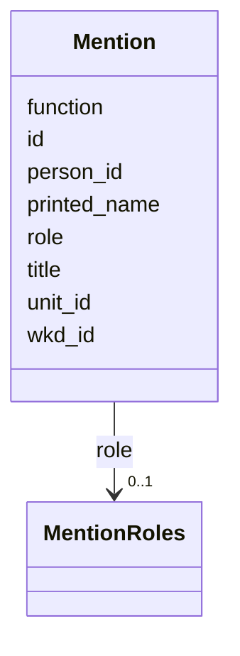

---
search:
  boost: 10.0
---

# Class: Mention 


_The older form of a person's mention in a piece of the paper: the person, the piece, the name as printed and the person's role there. The site's current mention is IssueMention._


<div data-search-exclude markdown="1">


URI: [pc:Mention](https://pruzhany.org/ns/sourced-entities#Mention)





<!-- no inheritance hierarchy -->

## Slots

| Name | Cardinality and Range | Description | Inheritance |
| ---  | --- | --- | --- |
| [id](id.md) | 1 <br/> [NonBlankText](NonBlankText.md) | The mention's id. | direct |
| [person_id](person_id.md) | 1 <br/> [NonBlankText](NonBlankText.md) | The person mentioned, by the person's id. | direct |
| [unit_id](unit_id.md) | 1 <br/> [NonBlankText](NonBlankText.md) | The piece of the paper the person is mentioned in, by its id. | direct |
| [printed_name](printed_name.md) | 1 <br/> [NonBlankText](NonBlankText.md) | The name as printed. | direct |
| [role](role.md) | 0..1 <br/> [MentionRoles](MentionRoles.md) | The person's role in the piece. | direct |
| [title](title.md) | 0..1 <br/> [String](String.md) | A title printed with the name. | direct |
| [function](function.md) | 0..1 <br/> [String](String.md) | A function printed with the name. | direct |
| [wkd_id](wkd_id.md) | 0..1 <br/> [String](String.md) | The person's Wikidata id, where one is linked. | direct |


## Identifier and Mapping Information


### Schema Source


* from schema: https://pruzhany.org/ns/site_common


## Mappings

| Mapping Type | Mapped Value |
| ---  | ---  |
| self | pc:Mention |
| native | pc:Mention |


## LinkML Source

<!-- TODO: investigate https://stackoverflow.com/questions/37606292/how-to-create-tabbed-code-blocks-in-mkdocs-or-sphinx -->

### Direct

<details>
```yaml
name: Mention
description: 'The older form of a person''s mention in a piece of the paper: the person,
  the piece, the name as printed and the person''s role there. The site''s current
  mention is IssueMention.'
from_schema: https://pruzhany.org/ns/site_common
rank: 1000
attributes:
  id:
    name: id
    description: The mention's id.
    from_schema: https://pruzhany.org/ns/sourced_entities
    domain_of:
    - Source
    - Fact
    - Mention
    range: NonBlankText
    required: true
  person_id:
    name: person_id
    description: The person mentioned, by the person's id.
    from_schema: https://pruzhany.org/ns/sourced_entities
    rank: 1000
    domain_of:
    - Mention
    range: NonBlankText
    required: true
  unit_id:
    name: unit_id
    description: The piece of the paper the person is mentioned in, by its id.
    from_schema: https://pruzhany.org/ns/sourced_entities
    domain_of:
    - Citation
    - Mention
    range: NonBlankText
    required: true
  printed_name:
    name: printed_name
    description: The name as printed.
    from_schema: https://pruzhany.org/ns/sourced_entities
    rank: 1000
    domain_of:
    - Mention
    range: NonBlankText
    required: true
  role:
    name: role
    description: The person's role in the piece.
    from_schema: https://pruzhany.org/ns/sourced_entities
    rank: 1000
    domain_of:
    - Mention
    range: MentionRoles
  title:
    name: title
    description: A title printed with the name.
    from_schema: https://pruzhany.org/ns/sourced_entities
    domain_of:
    - Source
    - Mention
    range: string
  function:
    name: function
    description: A function printed with the name.
    from_schema: https://pruzhany.org/ns/sourced_entities
    rank: 1000
    domain_of:
    - Mention
    range: string
  wkd_id:
    name: wkd_id
    description: The person's Wikidata id, where one is linked.
    from_schema: https://pruzhany.org/ns/sourced_entities
    rank: 1000
    domain_of:
    - Mention
    range: string

```
</details>

### Induced

<details>
```yaml
name: Mention
description: 'The older form of a person''s mention in a piece of the paper: the person,
  the piece, the name as printed and the person''s role there. The site''s current
  mention is IssueMention.'
from_schema: https://pruzhany.org/ns/site_common
rank: 1000
attributes:
  id:
    name: id
    description: The mention's id.
    from_schema: https://pruzhany.org/ns/sourced_entities
    owner: Mention
    domain_of:
    - Source
    - Fact
    - Mention
    range: NonBlankText
    required: true
  person_id:
    name: person_id
    description: The person mentioned, by the person's id.
    from_schema: https://pruzhany.org/ns/sourced_entities
    rank: 1000
    owner: Mention
    domain_of:
    - Mention
    range: NonBlankText
    required: true
  unit_id:
    name: unit_id
    description: The piece of the paper the person is mentioned in, by its id.
    from_schema: https://pruzhany.org/ns/sourced_entities
    owner: Mention
    domain_of:
    - Citation
    - Mention
    range: NonBlankText
    required: true
  printed_name:
    name: printed_name
    description: The name as printed.
    from_schema: https://pruzhany.org/ns/sourced_entities
    rank: 1000
    owner: Mention
    domain_of:
    - Mention
    range: NonBlankText
    required: true
  role:
    name: role
    description: The person's role in the piece.
    from_schema: https://pruzhany.org/ns/sourced_entities
    rank: 1000
    owner: Mention
    domain_of:
    - Mention
    range: MentionRoles
  title:
    name: title
    description: A title printed with the name.
    from_schema: https://pruzhany.org/ns/sourced_entities
    owner: Mention
    domain_of:
    - Source
    - Mention
    range: string
  function:
    name: function
    description: A function printed with the name.
    from_schema: https://pruzhany.org/ns/sourced_entities
    rank: 1000
    owner: Mention
    domain_of:
    - Mention
    range: string
  wkd_id:
    name: wkd_id
    description: The person's Wikidata id, where one is linked.
    from_schema: https://pruzhany.org/ns/sourced_entities
    rank: 1000
    owner: Mention
    domain_of:
    - Mention
    range: string

```
</details></div>
