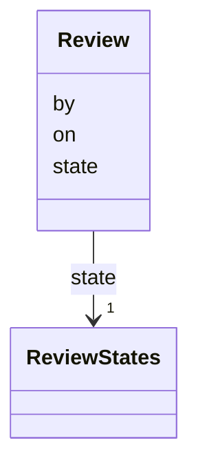

---
search:
  boost: 10.0
---

# Class: Review 


_Whether a person has reviewed a statement, who and on what day._


<div data-search-exclude markdown="1">


URI: [pc:Review](https://pruzhany.org/ns/sourced-entities#Review)





<!-- no inheritance hierarchy -->

## Slots

| Name | Cardinality and Range | Description | Inheritance |
| ---  | --- | --- | --- |
| [state](state.md) | 1 <br/> [ReviewStates](ReviewStates.md) | Pending, or approved by a reviewer. | direct |
| [by](by.md) | 0..1 <br/> [NonBlankText](NonBlankText.md) | Who reviewed it. | direct |
| [on](on.md) | 0..1 <br/> [IsoDay](IsoDay.md) | The day it was reviewed. | direct |


## Usages

| used by | used in | type | used |
| ---  | --- | --- | --- |
| [Fact](Fact.md) | [review](review.md) | range | [Review](Review.md) |
| [Fate](Fate.md) | [review](review.md) | range | [Review](Review.md) |


## Rules


### 

| Rule Applied | Preconditions | Postconditions | Elseconditions |
|--------------|---------------|----------------|----------------|
| slot_conditions |```{'state': {'equals_string': 'approved'}}``` |```{'by': {'required': True}, 'on': {'required': True}}``` | |


## Identifier and Mapping Information


### Schema Source


* from schema: https://pruzhany.org/ns/site_common


## Mappings

| Mapping Type | Mapped Value |
| ---  | ---  |
| self | pc:Review |
| native | pc:Review |


## LinkML Source

<!-- TODO: investigate https://stackoverflow.com/questions/37606292/how-to-create-tabbed-code-blocks-in-mkdocs-or-sphinx -->

### Direct

<details>
```yaml
name: Review
description: Whether a person has reviewed a statement, who and on what day.
from_schema: https://pruzhany.org/ns/site_common
rank: 1000
attributes:
  state:
    name: state
    description: Pending, or approved by a reviewer.
    from_schema: https://pruzhany.org/ns/sourced_entities
    rank: 1000
    domain_of:
    - Review
    range: ReviewStates
    required: true
  by:
    name: by
    description: Who reviewed it.
    from_schema: https://pruzhany.org/ns/sourced_entities
    rank: 1000
    domain_of:
    - Review
    - Attribution
    range: NonBlankText
  'on':
    name: 'on'
    description: The day it was reviewed.
    from_schema: https://pruzhany.org/ns/sourced_entities
    rank: 1000
    domain_of:
    - Review
    - Attribution
    range: IsoDay
rules:
- preconditions:
    slot_conditions:
      state:
        name: state
        equals_string: approved
  postconditions:
    slot_conditions:
      by:
        name: by
        required: true
      'on':
        name: 'on'
        required: true
  description: An approval names its reviewer and its day.

```
</details>

### Induced

<details>
```yaml
name: Review
description: Whether a person has reviewed a statement, who and on what day.
from_schema: https://pruzhany.org/ns/site_common
rank: 1000
attributes:
  state:
    name: state
    description: Pending, or approved by a reviewer.
    from_schema: https://pruzhany.org/ns/sourced_entities
    rank: 1000
    owner: Review
    domain_of:
    - Review
    range: ReviewStates
    required: true
  by:
    name: by
    description: Who reviewed it.
    from_schema: https://pruzhany.org/ns/sourced_entities
    rank: 1000
    owner: Review
    domain_of:
    - Review
    - Attribution
    range: NonBlankText
  'on':
    name: 'on'
    description: The day it was reviewed.
    from_schema: https://pruzhany.org/ns/sourced_entities
    rank: 1000
    owner: Review
    domain_of:
    - Review
    - Attribution
    range: IsoDay
rules:
- preconditions:
    slot_conditions:
      state:
        name: state
        equals_string: approved
  postconditions:
    slot_conditions:
      by:
        name: by
        required: true
      'on':
        name: 'on'
        required: true
  description: An approval names its reviewer and its day.

```
</details></div>
