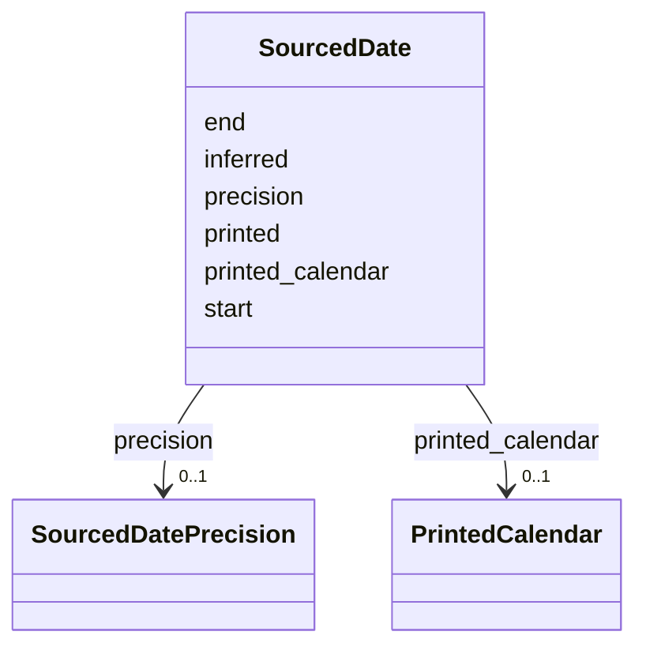

---
search:
  boost: 10.0
---

# Class: SourcedDate 


_A date a source gives: a normalized start (and end, for a range) with how precise it is, or the words as printed with their calendar, or both._


<div data-search-exclude markdown="1">


URI: [rico:Date](https://www.ica.org/standards/RiC/ontology#Date)





<!-- no inheritance hierarchy -->

## Class Properties

| Property | Value |
| --- | --- |
| Class URI | [rico:Date](https://www.ica.org/standards/RiC/ontology#Date) |


## Slots

| Name | Cardinality and Range | Description | Inheritance |
| ---  | --- | --- | --- |
| [start](start.md) | 0..1 <br/> [IsoYearMonthOrDay](IsoYearMonthOrDay.md) | The date's start, as far as it is known: YYYY, YYYY-MM or YYYY-MM-DD. | direct |
| [end](end.md) | 0..1 <br/> [IsoYearMonthOrDay](IsoYearMonthOrDay.md) | The end of a range of dates, written as the start is. | direct |
| [precision](precision.md) | 0..1 <br/> [SourcedDatePrecision](SourcedDatePrecision.md) | How much of the date is known: year, month, day or range. | direct |
| [printed](printed.md) | 0..1 <br/> [NonBlankText](NonBlankText.md) | The date's words as the source prints or writes them. | direct |
| [printed_calendar](printed_calendar.md) | 0..1 <br/> [PrintedCalendar](PrintedCalendar.md) | The calendar of the printed words. | direct |
| [inferred](inferred.md) | 0..1 <br/> [Boolean](Boolean.md) | True when the date was worked out rather than read. | direct |


## Usages

| used by | used in | type | used |
| ---  | --- | --- | --- |
| [Source](Source.md) | [dated](dated.md) | range | [SourcedDate](SourcedDate.md) |
| [Fact](Fact.md) | [date](date.md) | range | [SourcedDate](SourcedDate.md) |


## Rules


### 

| Rule Applied | Preconditions | Postconditions | Elseconditions |
|--------------|---------------|----------------|----------------|
| slot_conditions |```{'start': {'value_presence': 'ABSENT'}}``` |```{'printed': {'required': True}}``` | |


### 

| Rule Applied | Preconditions | Postconditions | Elseconditions |
|--------------|---------------|----------------|----------------|
| slot_conditions |```{'printed_calendar': {'value_presence': 'PRESENT'}}``` |```{'printed': {'required': True}}``` | |


### 

| Rule Applied | Preconditions | Postconditions | Elseconditions |
|--------------|---------------|----------------|----------------|
| slot_conditions |```{'end': {'value_presence': 'PRESENT'}}``` |```{'precision': {'equals_string': 'range'}}``` | |


### 

| Rule Applied | Preconditions | Postconditions | Elseconditions |
|--------------|---------------|----------------|----------------|
| slot_conditions |```{'precision': {'equals_string': 'range'}}``` |```{'start': {'required': True}, 'end': {'required': True}}``` | |


### 

| Rule Applied | Preconditions | Postconditions | Elseconditions |
|--------------|---------------|----------------|----------------|
| slot_conditions |```{'precision': {'equals_string': 'year'}}``` |```{'start': {'required': True, 'pattern': '^\\d{4}$'}}``` | |


### 

| Rule Applied | Preconditions | Postconditions | Elseconditions |
|--------------|---------------|----------------|----------------|
| slot_conditions |```{'precision': {'equals_string': 'month'}}``` |```{'start': {'required': True, 'pattern': '^\\d{4}-\\d{2}$'}}``` | |


### 

| Rule Applied | Preconditions | Postconditions | Elseconditions |
|--------------|---------------|----------------|----------------|
| slot_conditions |```{'precision': {'equals_string': 'day'}}``` |```{'start': {'required': True, 'pattern': '^\\d{4}-\\d{2}-\\d{2}$'}}``` | |


## Identifier and Mapping Information


### Schema Source


* from schema: https://pruzhany.org/ns/site_common


## Mappings

| Mapping Type | Mapped Value |
| ---  | ---  |
| self | rico:Date |
| native | pc:SourcedDate |


## LinkML Source

<!-- TODO: investigate https://stackoverflow.com/questions/37606292/how-to-create-tabbed-code-blocks-in-mkdocs-or-sphinx -->

### Direct

<details>
```yaml
name: SourcedDate
description: 'A date a source gives: a normalized start (and end, for a range) with
  how precise it is, or the words as printed with their calendar, or both.'
from_schema: https://pruzhany.org/ns/site_common
rank: 1000
attributes:
  start:
    name: start
    description: 'The date''s start, as far as it is known: YYYY, YYYY-MM or YYYY-MM-DD.'
    from_schema: https://pruzhany.org/ns/sourced_entities
    rank: 1000
    domain_of:
    - SourcedDate
    range: IsoYearMonthOrDay
  end:
    name: end
    description: The end of a range of dates, written as the start is.
    from_schema: https://pruzhany.org/ns/sourced_entities
    rank: 1000
    domain_of:
    - SourcedDate
    range: IsoYearMonthOrDay
  precision:
    name: precision
    description: 'How much of the date is known: year, month, day or range.'
    from_schema: https://pruzhany.org/ns/sourced_entities
    rank: 1000
    domain_of:
    - SourcedDate
    range: SourcedDatePrecision
  printed:
    name: printed
    description: The date's words as the source prints or writes them.
    from_schema: https://pruzhany.org/ns/sourced_entities
    rank: 1000
    slot_uri: rico:expressedDate
    domain_of:
    - SourcedDate
    range: NonBlankText
  printed_calendar:
    name: printed_calendar
    description: The calendar of the printed words.
    from_schema: https://pruzhany.org/ns/sourced_entities
    rank: 1000
    domain_of:
    - SourcedDate
    range: PrintedCalendar
  inferred:
    name: inferred
    description: True when the date was worked out rather than read.
    from_schema: https://pruzhany.org/ns/sourced_entities
    rank: 1000
    domain_of:
    - SourcedDate
    range: boolean
class_uri: rico:Date
rules:
- preconditions:
    slot_conditions:
      start:
        name: start
        value_presence: ABSENT
  postconditions:
    slot_conditions:
      printed:
        name: printed
        required: true
  description: A sourced date without a start has printed words.
- preconditions:
    slot_conditions:
      printed_calendar:
        name: printed_calendar
        value_presence: PRESENT
  postconditions:
    slot_conditions:
      printed:
        name: printed
        required: true
  description: A sourced date with a calendar has printed words.
- preconditions:
    slot_conditions:
      end:
        name: end
        value_presence: PRESENT
  postconditions:
    slot_conditions:
      precision:
        name: precision
        equals_string: range
  description: A sourced date with an end is a range.
- preconditions:
    slot_conditions:
      precision:
        name: precision
        equals_string: range
  postconditions:
    slot_conditions:
      start:
        name: start
        required: true
      end:
        name: end
        required: true
  description: A range has a start and an end.
- preconditions:
    slot_conditions:
      precision:
        name: precision
        equals_string: year
  postconditions:
    slot_conditions:
      start:
        name: start
        required: true
        pattern: ^\d{4}$
  description: A date known to the year has a start of a year.
- preconditions:
    slot_conditions:
      precision:
        name: precision
        equals_string: month
  postconditions:
    slot_conditions:
      start:
        name: start
        required: true
        pattern: ^\d{4}-\d{2}$
  description: A date known to the month has a start of a month.
- preconditions:
    slot_conditions:
      precision:
        name: precision
        equals_string: day
  postconditions:
    slot_conditions:
      start:
        name: start
        required: true
        pattern: ^\d{4}-\d{2}-\d{2}$
  description: A date known to the day has a start of a day.

```
</details>

### Induced

<details>
```yaml
name: SourcedDate
description: 'A date a source gives: a normalized start (and end, for a range) with
  how precise it is, or the words as printed with their calendar, or both.'
from_schema: https://pruzhany.org/ns/site_common
rank: 1000
attributes:
  start:
    name: start
    description: 'The date''s start, as far as it is known: YYYY, YYYY-MM or YYYY-MM-DD.'
    from_schema: https://pruzhany.org/ns/sourced_entities
    rank: 1000
    owner: SourcedDate
    domain_of:
    - SourcedDate
    range: IsoYearMonthOrDay
  end:
    name: end
    description: The end of a range of dates, written as the start is.
    from_schema: https://pruzhany.org/ns/sourced_entities
    rank: 1000
    owner: SourcedDate
    domain_of:
    - SourcedDate
    range: IsoYearMonthOrDay
  precision:
    name: precision
    description: 'How much of the date is known: year, month, day or range.'
    from_schema: https://pruzhany.org/ns/sourced_entities
    rank: 1000
    owner: SourcedDate
    domain_of:
    - SourcedDate
    range: SourcedDatePrecision
  printed:
    name: printed
    description: The date's words as the source prints or writes them.
    from_schema: https://pruzhany.org/ns/sourced_entities
    rank: 1000
    slot_uri: rico:expressedDate
    owner: SourcedDate
    domain_of:
    - SourcedDate
    range: NonBlankText
  printed_calendar:
    name: printed_calendar
    description: The calendar of the printed words.
    from_schema: https://pruzhany.org/ns/sourced_entities
    rank: 1000
    owner: SourcedDate
    domain_of:
    - SourcedDate
    range: PrintedCalendar
  inferred:
    name: inferred
    description: True when the date was worked out rather than read.
    from_schema: https://pruzhany.org/ns/sourced_entities
    rank: 1000
    owner: SourcedDate
    domain_of:
    - SourcedDate
    range: boolean
class_uri: rico:Date
rules:
- preconditions:
    slot_conditions:
      start:
        name: start
        value_presence: ABSENT
  postconditions:
    slot_conditions:
      printed:
        name: printed
        required: true
  description: A sourced date without a start has printed words.
- preconditions:
    slot_conditions:
      printed_calendar:
        name: printed_calendar
        value_presence: PRESENT
  postconditions:
    slot_conditions:
      printed:
        name: printed
        required: true
  description: A sourced date with a calendar has printed words.
- preconditions:
    slot_conditions:
      end:
        name: end
        value_presence: PRESENT
  postconditions:
    slot_conditions:
      precision:
        name: precision
        equals_string: range
  description: A sourced date with an end is a range.
- preconditions:
    slot_conditions:
      precision:
        name: precision
        equals_string: range
  postconditions:
    slot_conditions:
      start:
        name: start
        required: true
      end:
        name: end
        required: true
  description: A range has a start and an end.
- preconditions:
    slot_conditions:
      precision:
        name: precision
        equals_string: year
  postconditions:
    slot_conditions:
      start:
        name: start
        required: true
        pattern: ^\d{4}$
  description: A date known to the year has a start of a year.
- preconditions:
    slot_conditions:
      precision:
        name: precision
        equals_string: month
  postconditions:
    slot_conditions:
      start:
        name: start
        required: true
        pattern: ^\d{4}-\d{2}$
  description: A date known to the month has a start of a month.
- preconditions:
    slot_conditions:
      precision:
        name: precision
        equals_string: day
  postconditions:
    slot_conditions:
      start:
        name: start
        required: true
        pattern: ^\d{4}-\d{2}-\d{2}$
  description: A date known to the day has a start of a day.

```
</details></div>
