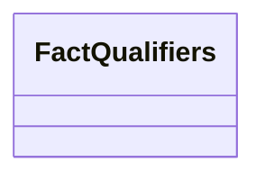

---
search:
  boost: 10.0
---

# Class: FactQualifiers 


_More about a fact, as named texts: how many children a notice names, how a statement is supported and the like._


<div data-search-exclude markdown="1">


URI: [pc:FactQualifiers](https://pruzhany.org/ns/sourced-entities#FactQualifiers)





<!-- no inheritance hierarchy -->

## Slots

| Name | Cardinality and Range | Description | Inheritance |
| ---  | --- | --- | --- |


## Usages

| used by | used in | type | used |
| ---  | --- | --- | --- |
| [Fact](Fact.md) | [qualifiers](qualifiers.md) | range | [FactQualifiers](FactQualifiers.md) |


## Identifier and Mapping Information


### Schema Source


* from schema: https://pruzhany.org/ns/sourced_entities


## Mappings

| Mapping Type | Mapped Value |
| ---  | ---  |
| self | pc:FactQualifiers |
| native | pc:FactQualifiers |


## LinkML Source

<!-- TODO: investigate https://stackoverflow.com/questions/37606292/how-to-create-tabbed-code-blocks-in-mkdocs-or-sphinx -->

### Direct

<details>
```yaml
name: FactQualifiers
description: 'More about a fact, as named texts: how many children a notice names,
  how a statement is supported and the like.'
from_schema: https://pruzhany.org/ns/sourced_entities
rank: 1000
extra_slots:
  range_expression:
    range: string
    required: true

```
</details>

### Induced

<details>
```yaml
name: FactQualifiers
description: 'More about a fact, as named texts: how many children a notice names,
  how a statement is supported and the like.'
from_schema: https://pruzhany.org/ns/sourced_entities
rank: 1000
extra_slots:
  range_expression:
    range: string
    required: true

```
</details></div>
