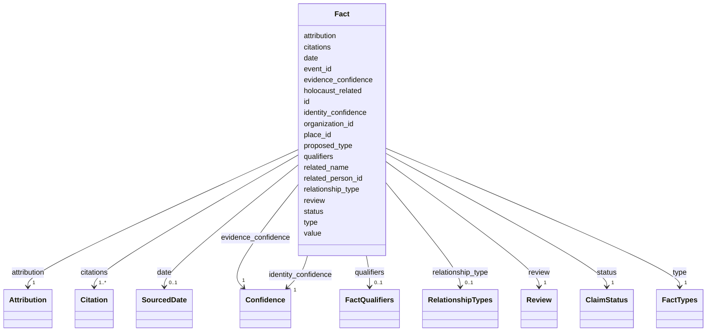

---
search:
  boost: 10.0
---

# Class: Fact 


_One source's statement about a person, a family or a relation, kept as that source gives it, with its evidence, its confidence, its standing and who recorded it. What it means depends on its type (see FactTypes)._


<div data-search-exclude markdown="1">


URI: [pc:Fact](https://pruzhany.org/ns/sourced-entities#Fact)





<!-- no inheritance hierarchy -->

## Slots

| Name | Cardinality and Range | Description | Inheritance |
| ---  | --- | --- | --- |
| [id](id.md) | 1 <br/> [NonBlankText](NonBlankText.md) | The fact's id in the record. | direct |
| [type](type.md) | 1 <br/> [FactTypes](FactTypes.md) | What the statement is about: a birth, a death, a residence, an occupation and so on. | direct |
| [proposed_type](proposed_type.md) | 0..1 <br/> [NonBlankText](NonBlankText.md) | For a statement of type other: the type proposed for it, awaiting the owner's approval. | direct |
| [value](value.md) | 0..1 <br/> [NonBlankText](NonBlankText.md) | The statement's words or value, such as an occupation. | direct |
| [date](date.md) | 0..1 <br/> [SourcedDate](SourcedDate.md) | When, as the source gives it. | direct |
| [place_id](place_id.md) | 0..1 <br/> [NonBlankText](NonBlankText.md) | Where, by the place's id in the record. | direct |
| [organization_id](organization_id.md) | 0..1 <br/> [NonBlankText](NonBlankText.md) | The organisation the statement concerns, by its id in the record. | direct |
| [event_id](event_id.md) | 0..1 <br/> [NonBlankText](NonBlankText.md) | The life event the statement concerns, by its id in the record. | direct |
| [related_person_id](related_person_id.md) | 0..1 <br/> [NonBlankText](NonBlankText.md) | For kinship: the relative, by the person's id in the record. | direct |
| [relationship_type](relationship_type.md) | 0..1 <br/> [RelationshipTypes](RelationshipTypes.md) | For kinship: how the relative is related, from the subject to the relative. | direct |
| [related_name](related_name.md) | 0..1 <br/> [NonBlankText](NonBlankText.md) | For kinship: the relative's name, where the relative has no person of their own. | direct |
| [qualifiers](qualifiers.md) | 0..1 <br/> [FactQualifiers](FactQualifiers.md) | More about the statement, as named texts. | direct |
| [holocaust_related](holocaust_related.md) | 0..1 <br/> [Boolean](Boolean.md) | True when the statement concerns the Holocaust. | direct |
| [citations](citations.md) | 1..* <br/> [Citation](Citation.md) | The evidence: where in which sources the statement is found. | direct |
| [evidence_confidence](evidence_confidence.md) | 1 <br/> [Confidence](Confidence.md) | How sure the evidence makes the statement. | direct |
| [identity_confidence](identity_confidence.md) | 1 <br/> [Confidence](Confidence.md) | How sure it is that the statement is about this person. | direct |
| [status](status.md) | 1 <br/> [ClaimStatus](ClaimStatus.md) | The statement's standing: proposed, accepted, disputed or rejected. | direct |
| [review](review.md) | 1 <br/> [Review](Review.md) | Whether a person has reviewed the statement. | direct |
| [attribution](attribution.md) | 1 <br/> [Attribution](Attribution.md) | Who recorded the statement, and on what day. | direct |


## Rules


### 

| Rule Applied | Preconditions | Postconditions | Elseconditions |
|--------------|---------------|----------------|----------------|
| slot_conditions |```{'type': {'equals_string': 'other'}}``` |```{'proposed_type': {'required': True}}``` |```{'proposed_type': {'value_presence': 'ABSENT'}}``` |


### 

| Rule Applied | Preconditions | Postconditions | Elseconditions |
|--------------|---------------|----------------|----------------|
| slot_conditions |```{'type': {'equals_string': 'kinship'}}``` |```{'relationship_type': {'required': True}}``` | |
| any_of | |```[{'slot_conditions': {'related_name': {'required': True}}}, {'slot_conditions': {'related_person_id': {'required': True}}}]``` | |


### 

| Rule Applied | Preconditions | Postconditions | Elseconditions |
|--------------|---------------|----------------|----------------|
| slot_conditions |```{'type': {'equals_string': 'occupation'}}``` |```{'value': {'required': True}}``` | |


### 

| Rule Applied | Preconditions | Postconditions | Elseconditions |
|--------------|---------------|----------------|----------------|
| slot_conditions |```{'type': {'equals_string': 'residence'}}``` | | |
| any_of | |```[{'slot_conditions': {'place_id': {'required': True}}}, {'slot_conditions': {'value': {'required': True}}}]``` | |


### 

| Rule Applied | Preconditions | Postconditions | Elseconditions |
|--------------|---------------|----------------|----------------|
| slot_conditions |```{'type': {'equals_string': 'event_participation'}}``` |```{'event_id': {'required': True}}``` | |


### 

| Rule Applied | Preconditions | Postconditions | Elseconditions |
|--------------|---------------|----------------|----------------|
| slot_conditions |```{'type': {'equals_string_in': ['birth', 'death']}}``` | | |
| any_of | |```[{'slot_conditions': {'date': {'required': True}}}, {'slot_conditions': {'place_id': {'required': True}}}, {'slot_conditions': {'value': {'required': True}}}]``` | |


## Identifier and Mapping Information


### Schema Source


* from schema: https://pruzhany.org/ns/sourced_entities


## Mappings

| Mapping Type | Mapped Value |
| ---  | ---  |
| self | pc:Fact |
| native | pc:Fact |


## LinkML Source

<!-- TODO: investigate https://stackoverflow.com/questions/37606292/how-to-create-tabbed-code-blocks-in-mkdocs-or-sphinx -->

### Direct

<details>
```yaml
name: Fact
description: One source's statement about a person, a family or a relation, kept as
  that source gives it, with its evidence, its confidence, its standing and who recorded
  it. What it means depends on its type (see FactTypes).
from_schema: https://pruzhany.org/ns/sourced_entities
rank: 1000
attributes:
  id:
    name: id
    description: The fact's id in the record.
    from_schema: https://pruzhany.org/ns/sourced_entities
    domain_of:
    - Source
    - Fact
    - Mention
    range: NonBlankText
    required: true
  type:
    name: type
    description: 'What the statement is about: a birth, a death, a residence, an occupation
      and so on.'
    from_schema: https://pruzhany.org/ns/sourced_entities
    rank: 1000
    domain_of:
    - Fact
    range: FactTypes
    required: true
  proposed_type:
    name: proposed_type
    description: 'For a statement of type other: the type proposed for it, awaiting
      the owner''s approval.'
    from_schema: https://pruzhany.org/ns/sourced_entities
    rank: 1000
    domain_of:
    - Fact
    range: NonBlankText
  value:
    name: value
    description: The statement's words or value, such as an occupation.
    from_schema: https://pruzhany.org/ns/sourced_entities
    rank: 1000
    domain_of:
    - Fact
    - Name
    range: NonBlankText
  date:
    name: date
    description: When, as the source gives it.
    from_schema: https://pruzhany.org/ns/sourced_entities
    rank: 1000
    domain_of:
    - Fact
    range: SourcedDate
    inlined: true
  place_id:
    name: place_id
    description: Where, by the place's id in the record.
    from_schema: https://pruzhany.org/ns/sourced_entities
    rank: 1000
    domain_of:
    - Fact
    range: NonBlankText
  organization_id:
    name: organization_id
    description: The organisation the statement concerns, by its id in the record.
    from_schema: https://pruzhany.org/ns/sourced_entities
    rank: 1000
    domain_of:
    - Fact
    range: NonBlankText
  event_id:
    name: event_id
    annotations:
      references:
        tag: references
        value: SharedEvent.id
    description: The life event the statement concerns, by its id in the record.
    from_schema: https://pruzhany.org/ns/sourced_entities
    rank: 1000
    domain_of:
    - Fact
    range: NonBlankText
  related_person_id:
    name: related_person_id
    description: 'For kinship: the relative, by the person''s id in the record.'
    from_schema: https://pruzhany.org/ns/sourced_entities
    rank: 1000
    domain_of:
    - Fact
    range: NonBlankText
  relationship_type:
    name: relationship_type
    description: 'For kinship: how the relative is related, from the subject to the
      relative.'
    from_schema: https://pruzhany.org/ns/sourced_entities
    rank: 1000
    domain_of:
    - Fact
    range: RelationshipTypes
  related_name:
    name: related_name
    description: 'For kinship: the relative''s name, where the relative has no person
      of their own.'
    from_schema: https://pruzhany.org/ns/sourced_entities
    rank: 1000
    domain_of:
    - Fact
    range: NonBlankText
  qualifiers:
    name: qualifiers
    description: More about the statement, as named texts.
    from_schema: https://pruzhany.org/ns/sourced_entities
    rank: 1000
    domain_of:
    - Fact
    range: FactQualifiers
    inlined: true
  holocaust_related:
    name: holocaust_related
    description: True when the statement concerns the Holocaust.
    from_schema: https://pruzhany.org/ns/sourced_entities
    rank: 1000
    domain_of:
    - Fact
    range: boolean
  citations:
    name: citations
    description: 'The evidence: where in which sources the statement is found.'
    from_schema: https://pruzhany.org/ns/sourced_entities
    rank: 1000
    domain_of:
    - Fact
    - Name
    range: Citation
    required: true
    multivalued: true
    inlined_as_list: true
    minimum_cardinality: 1
  evidence_confidence:
    name: evidence_confidence
    description: How sure the evidence makes the statement.
    from_schema: https://pruzhany.org/ns/sourced_entities
    rank: 1000
    slot_uri: rico:relationCertainty
    domain_of:
    - Fact
    range: Confidence
    required: true
  identity_confidence:
    name: identity_confidence
    description: How sure it is that the statement is about this person.
    from_schema: https://pruzhany.org/ns/sourced_entities
    rank: 1000
    domain_of:
    - Fact
    range: Confidence
    required: true
  status:
    name: status
    description: 'The statement''s standing: proposed, accepted, disputed or rejected.'
    from_schema: https://pruzhany.org/ns/sourced_entities
    related_mappings:
    - pc:site_standing
    rank: 1000
    domain_of:
    - Fact
    range: ClaimStatus
    required: true
  review:
    name: review
    description: Whether a person has reviewed the statement.
    from_schema: https://pruzhany.org/ns/sourced_entities
    related_mappings:
    - pc:site_standing
    rank: 1000
    domain_of:
    - Fact
    - Fate
    range: Review
    required: true
    inlined: true
  attribution:
    name: attribution
    description: Who recorded the statement, and on what day.
    from_schema: https://pruzhany.org/ns/sourced_entities
    rank: 1000
    domain_of:
    - Fact
    - Name
    range: Attribution
    required: true
    inlined: true
rules:
- preconditions:
    slot_conditions:
      type:
        name: type
        equals_string: other
  postconditions:
    slot_conditions:
      proposed_type:
        name: proposed_type
        required: true
  elseconditions:
    slot_conditions:
      proposed_type:
        name: proposed_type
        value_presence: ABSENT
  description: A fact of type other has a proposed type, and only such a fact has
    one.
- preconditions:
    slot_conditions:
      type:
        name: type
        equals_string: kinship
  postconditions:
    any_of:
    - slot_conditions:
        related_name:
          name: related_name
          required: true
    - slot_conditions:
        related_person_id:
          name: related_person_id
          required: true
    slot_conditions:
      relationship_type:
        name: relationship_type
        required: true
  description: A kinship fact names the relationship and the relative.
- preconditions:
    slot_conditions:
      type:
        name: type
        equals_string: occupation
  postconditions:
    slot_conditions:
      value:
        name: value
        required: true
  description: An occupation fact has its value.
- preconditions:
    slot_conditions:
      type:
        name: type
        equals_string: residence
  postconditions:
    any_of:
    - slot_conditions:
        place_id:
          name: place_id
          required: true
    - slot_conditions:
        value:
          name: value
          required: true
  description: A residence fact has a place or a value.
- preconditions:
    slot_conditions:
      type:
        name: type
        equals_string: event_participation
  postconditions:
    slot_conditions:
      event_id:
        name: event_id
        required: true
  description: A fact of taking part names its event.
- preconditions:
    slot_conditions:
      type:
        name: type
        equals_string_in:
        - birth
        - death
  postconditions:
    any_of:
    - slot_conditions:
        date:
          name: date
          required: true
    - slot_conditions:
        place_id:
          name: place_id
          required: true
    - slot_conditions:
        value:
          name: value
          required: true
  description: A birth or death fact has a date, a place or a value.

```
</details>

### Induced

<details>
```yaml
name: Fact
description: One source's statement about a person, a family or a relation, kept as
  that source gives it, with its evidence, its confidence, its standing and who recorded
  it. What it means depends on its type (see FactTypes).
from_schema: https://pruzhany.org/ns/sourced_entities
rank: 1000
attributes:
  id:
    name: id
    description: The fact's id in the record.
    from_schema: https://pruzhany.org/ns/sourced_entities
    owner: Fact
    domain_of:
    - Source
    - Fact
    - Mention
    range: NonBlankText
    required: true
  type:
    name: type
    description: 'What the statement is about: a birth, a death, a residence, an occupation
      and so on.'
    from_schema: https://pruzhany.org/ns/sourced_entities
    rank: 1000
    owner: Fact
    domain_of:
    - Fact
    range: FactTypes
    required: true
  proposed_type:
    name: proposed_type
    description: 'For a statement of type other: the type proposed for it, awaiting
      the owner''s approval.'
    from_schema: https://pruzhany.org/ns/sourced_entities
    rank: 1000
    owner: Fact
    domain_of:
    - Fact
    range: NonBlankText
  value:
    name: value
    description: The statement's words or value, such as an occupation.
    from_schema: https://pruzhany.org/ns/sourced_entities
    rank: 1000
    owner: Fact
    domain_of:
    - Fact
    - Name
    range: NonBlankText
  date:
    name: date
    description: When, as the source gives it.
    from_schema: https://pruzhany.org/ns/sourced_entities
    rank: 1000
    owner: Fact
    domain_of:
    - Fact
    range: SourcedDate
    inlined: true
  place_id:
    name: place_id
    description: Where, by the place's id in the record.
    from_schema: https://pruzhany.org/ns/sourced_entities
    rank: 1000
    owner: Fact
    domain_of:
    - Fact
    range: NonBlankText
  organization_id:
    name: organization_id
    description: The organisation the statement concerns, by its id in the record.
    from_schema: https://pruzhany.org/ns/sourced_entities
    rank: 1000
    owner: Fact
    domain_of:
    - Fact
    range: NonBlankText
  event_id:
    name: event_id
    annotations:
      references:
        tag: references
        value: SharedEvent.id
    description: The life event the statement concerns, by its id in the record.
    from_schema: https://pruzhany.org/ns/sourced_entities
    rank: 1000
    owner: Fact
    domain_of:
    - Fact
    range: NonBlankText
  related_person_id:
    name: related_person_id
    description: 'For kinship: the relative, by the person''s id in the record.'
    from_schema: https://pruzhany.org/ns/sourced_entities
    rank: 1000
    owner: Fact
    domain_of:
    - Fact
    range: NonBlankText
  relationship_type:
    name: relationship_type
    description: 'For kinship: how the relative is related, from the subject to the
      relative.'
    from_schema: https://pruzhany.org/ns/sourced_entities
    rank: 1000
    owner: Fact
    domain_of:
    - Fact
    range: RelationshipTypes
  related_name:
    name: related_name
    description: 'For kinship: the relative''s name, where the relative has no person
      of their own.'
    from_schema: https://pruzhany.org/ns/sourced_entities
    rank: 1000
    owner: Fact
    domain_of:
    - Fact
    range: NonBlankText
  qualifiers:
    name: qualifiers
    description: More about the statement, as named texts.
    from_schema: https://pruzhany.org/ns/sourced_entities
    rank: 1000
    owner: Fact
    domain_of:
    - Fact
    range: FactQualifiers
    inlined: true
  holocaust_related:
    name: holocaust_related
    description: True when the statement concerns the Holocaust.
    from_schema: https://pruzhany.org/ns/sourced_entities
    rank: 1000
    owner: Fact
    domain_of:
    - Fact
    range: boolean
  citations:
    name: citations
    description: 'The evidence: where in which sources the statement is found.'
    from_schema: https://pruzhany.org/ns/sourced_entities
    rank: 1000
    owner: Fact
    domain_of:
    - Fact
    - Name
    range: Citation
    required: true
    multivalued: true
    inlined: true
    inlined_as_list: true
    minimum_cardinality: 1
  evidence_confidence:
    name: evidence_confidence
    description: How sure the evidence makes the statement.
    from_schema: https://pruzhany.org/ns/sourced_entities
    rank: 1000
    slot_uri: rico:relationCertainty
    owner: Fact
    domain_of:
    - Fact
    range: Confidence
    required: true
  identity_confidence:
    name: identity_confidence
    description: How sure it is that the statement is about this person.
    from_schema: https://pruzhany.org/ns/sourced_entities
    rank: 1000
    owner: Fact
    domain_of:
    - Fact
    range: Confidence
    required: true
  status:
    name: status
    description: 'The statement''s standing: proposed, accepted, disputed or rejected.'
    from_schema: https://pruzhany.org/ns/sourced_entities
    related_mappings:
    - pc:site_standing
    rank: 1000
    owner: Fact
    domain_of:
    - Fact
    range: ClaimStatus
    required: true
  review:
    name: review
    description: Whether a person has reviewed the statement.
    from_schema: https://pruzhany.org/ns/sourced_entities
    related_mappings:
    - pc:site_standing
    rank: 1000
    owner: Fact
    domain_of:
    - Fact
    - Fate
    range: Review
    required: true
    inlined: true
  attribution:
    name: attribution
    description: Who recorded the statement, and on what day.
    from_schema: https://pruzhany.org/ns/sourced_entities
    rank: 1000
    owner: Fact
    domain_of:
    - Fact
    - Name
    range: Attribution
    required: true
    inlined: true
rules:
- preconditions:
    slot_conditions:
      type:
        name: type
        equals_string: other
  postconditions:
    slot_conditions:
      proposed_type:
        name: proposed_type
        required: true
  elseconditions:
    slot_conditions:
      proposed_type:
        name: proposed_type
        value_presence: ABSENT
  description: A fact of type other has a proposed type, and only such a fact has
    one.
- preconditions:
    slot_conditions:
      type:
        name: type
        equals_string: kinship
  postconditions:
    any_of:
    - slot_conditions:
        related_name:
          name: related_name
          required: true
    - slot_conditions:
        related_person_id:
          name: related_person_id
          required: true
    slot_conditions:
      relationship_type:
        name: relationship_type
        required: true
  description: A kinship fact names the relationship and the relative.
- preconditions:
    slot_conditions:
      type:
        name: type
        equals_string: occupation
  postconditions:
    slot_conditions:
      value:
        name: value
        required: true
  description: An occupation fact has its value.
- preconditions:
    slot_conditions:
      type:
        name: type
        equals_string: residence
  postconditions:
    any_of:
    - slot_conditions:
        place_id:
          name: place_id
          required: true
    - slot_conditions:
        value:
          name: value
          required: true
  description: A residence fact has a place or a value.
- preconditions:
    slot_conditions:
      type:
        name: type
        equals_string: event_participation
  postconditions:
    slot_conditions:
      event_id:
        name: event_id
        required: true
  description: A fact of taking part names its event.
- preconditions:
    slot_conditions:
      type:
        name: type
        equals_string_in:
        - birth
        - death
  postconditions:
    any_of:
    - slot_conditions:
        date:
          name: date
          required: true
    - slot_conditions:
        place_id:
          name: place_id
          required: true
    - slot_conditions:
        value:
          name: value
          required: true
  description: A birth or death fact has a date, a place or a value.

```
</details></div>
